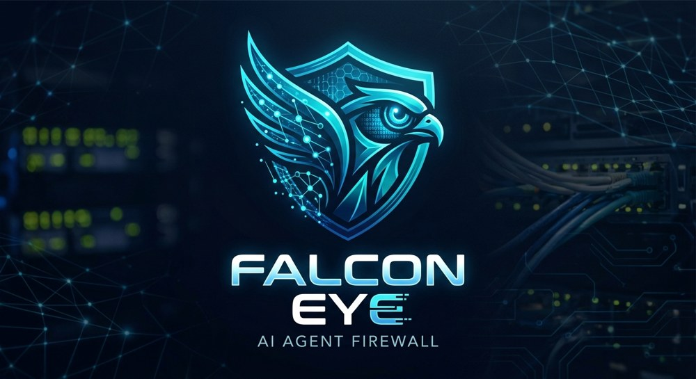

<p align="center"></p>

# Falcon Eye  Multi-User AI Agent Firewall

**Powerful security. Simple experience.**

Falcon Eye sits between your AI agents and the actions they want to take. Each agent asks Falcon Eye first; Falcon Eye checks your policies and answers **ALLOW**, **BLOCK** or **REQUIRE_APPROVAL**, records the decision, and shows everything on a dashboard. Falcon Eye *decides*; your agent *executes*.

## Quick start (development)
```bash
python -m venv .venv
# Windows: .venv\Scripts\Activate.ps1      macOS/Linux: source .venv/bin/activate
pip install -r requirements-dev.txt
cp .env.example .env        # then set JWT_SECRET_KEY (see docs/ENVIRONMENT.md)
python -m uvicorn main:app --reload     # the database is created/upgraded automatically
```
In a second terminal:
```bash
cd frontend
npm install
npm run dev
```
Open http://localhost:5173, create an account and follow the onboarding. API docs: http://127.0.0.1:8000/docs

## Docker
`cp .env.example .env`, fill in the secrets, then `docker compose up --build -d` and open http://localhost:8080. See [Docker guide](docs/DOCKER.md).

## Documentation
- [Installation](docs/INSTALLATION.md) · [Environment variables](docs/ENVIRONMENT.md) · [Docker](docs/DOCKER.md)
- [User guide](docs/USER_GUIDE.md) · [Policies](docs/POLICIES.md) · [Agent integration](docs/AGENT_INTEGRATION.md)
- [API reference](docs/API.md) · [Architecture](docs/ARCHITECTURE.md) · [Database & migrations](docs/DATABASE.md)
- [Troubleshooting](docs/TROUBLESHOOTING.md) · [Known limitations](docs/LIMITATIONS.md)

## Status
Prepared for formal testing and security review. It has **not** been independently penetration-tested, and the backend API tests have not yet been run end to end: see the [testing report](docs/TESTING_REPORT.md). Read the [limitations](docs/LIMITATIONS.md) before deploying.

`legacy_backup/` holds your original single-user files, untouched, for reference.
